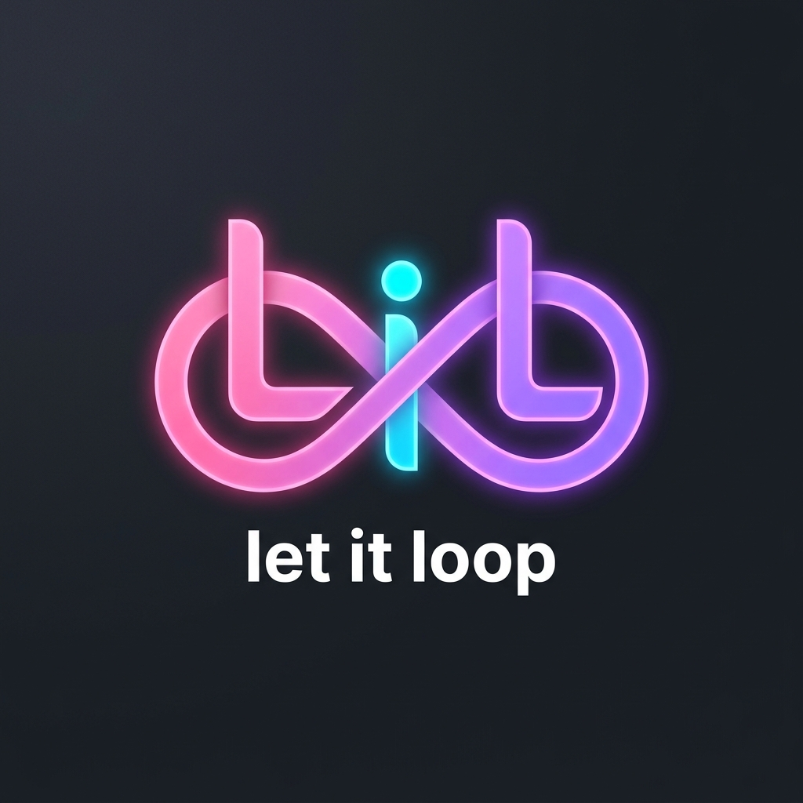
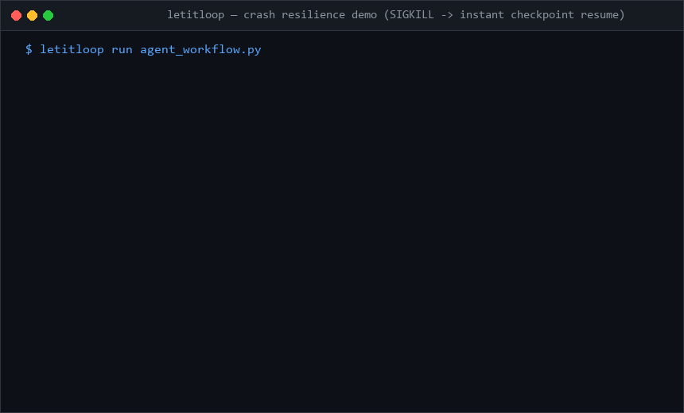

<p align="center">
  
</p>

<div align="center">

# let it loop (LIL)

**Single-Process Local Write-Ahead Log (`LILWAL02`) & Process Supervisor for Python Scripts (`v0.7.3`)**

[](https://sdageltc.github.io/letitloop/)
[](https://pypi.org/project/letitloop/)
[](https://github.com/sdageltc/letitloop/actions/workflows/ci.yml)
[](https://github.com/sdageltc/letitloop-action)
[](https://sdageltc.github.io/agent-durability-bench/)
[](https://www.python.org/downloads/)
[](https://opensource.org/licenses/MIT)

**[Official Website](https://sdageltc.github.io/letitloop/)** • **[Architecture & Trade-Offs](docs/ARCHITECTURE_AND_TRADE_OFFS.md)** • **[DCP-2.0 Simulation Harness](https://sdageltc.github.io/agent-durability-bench/)** • **[PyPI Package](https://pypi.org/project/letitloop/)**

</div>

---

> **Status & Scope**: `letitloop` is a single-maintainer, single-writer local filesystem Write-Ahead Log (`LILWAL02`) and process supervisor (`lil watch` / `@supervise`) for Python functions, scrapers, and batch scripts. It requires only `psutil>=5.9.0` and stores state in human-readable, CRC32-framed JSONL files.

---

<p align="center">
  
</p>

## ⚡ Quickstart

```python
from letitloop import atomic_marker, durable, step


@durable(goal_id="customer_sync", wal_dir=".durable_wal")
def sync_workflow():
    # If this process crashes or receives SIGKILL midway,
    # completed steps are skipped from the local WAL on restart.
    user = step("fetch_user", fetch_crm_record, user_id=123)
    summary = step("summarize", call_llm_model, user)

    # Guard local side effects with a 2-phase file marker
    with atomic_marker("slack_notification") as should_execute:
        if should_execute:
            step("notify", send_slack, summary)

    return summary


if __name__ == "__main__":
    sync_workflow()
```

```bash
pip install letitloop
```

For asynchronous pipelines, use `@durable_async` and `await async_step(...)` with `ContextVar` isolation across `asyncio.gather()`.

### Interactive Crash-Recovery Visualizer

Run the local Streamlit visualizer (uses deterministic local steps, zero external API calls):

```bash
python -m pip install -e .
python -m pip install -r examples/interactive_demo/requirements.txt
streamlit run examples/interactive_demo/app.py
```

---

## 🧭 When to Use LetItLoop (and When Not To)

| Workload / Requirement | Recommended Tool | Why |
|---|---|---|
| **Single-writer local Python script, scraper, or CLI job** | **LetItLoop (`@durable` + `lil watch`)** | Zero external daemon, human-readable JSONL WAL (`LILWAL02`) with CRC32 + SHA-256 hash chain, and built-in subprocess crash supervision (`lil watch`). |
| **SQLite / PostgreSQL transactional workflows with durable `sleep` & queues** | **[DBOS (`dbos`)](https://github.com/dbos-inc/dbos-transact-py)** | Runs in-process on SQLite by default with a production PostgreSQL upgrade path and official PydanticAI / OpenAI Agents SDK integrations. |
| **LangGraph graph or `@entrypoint` / `@task` pipelines** | **[LangGraph `SqliteSaver`](https://pypi.org/project/langgraph-checkpoint-sqlite/)** | Native checkpointer maintained by the LangGraph core team. |
| **Data engineering DAGs & scheduled flows** | **[Prefect](https://github.com/PrefectHQ/prefect)** | Mature Python `@flow` / `@task` engine with ephemeral local SQLite mode and observability UI. |
| **Multi-node distributed microservices & multi-day timers** | **[Temporal](https://github.com/temporalio/sdk-python)** or **[Restate](https://github.com/restatedev/sdk-python)** | Dedicated workflow server clusters with distributed event histories and multi-language workers. |

See [docs/ARCHITECTURE_AND_TRADE_OFFS.md](docs/ARCHITECTURE_AND_TRADE_OFFS.md) for a detailed architectural analysis and contract boundaries.

---

## 🔄 Process Liveness: Auto-Supervision & CLI Watcher

LetItLoop pairs **State Durability** (saving step outputs to disk) with **Process Liveness** (restarting a script after `SIGKILL 137` or an unhandled crash):

### 1. Terminal Watcher (`lil watch`)
Supervise any Python script with sliding-window rapid-failure circuit breaking and clean signal forwarding:

```bash
lil watch agent_pipeline.py --max-restarts 10 --backoff 1.0
```

### 2. Entrypoint Decorator (`@supervise`)
```python
from letitloop import durable, step, supervise


@supervise(max_restarts=5, backoff=1.0)
@durable(goal_id="equity_analyst", wal_dir=".equity_wal")
def run_pipeline():
    user = step("fetch_data", fetch_financials)
    report = step("generate_report", analyze, user)
    return report


if __name__ == "__main__":
    run_pipeline()
```

---

## 💎 Core Design Guarantees & Contract Boundaries

1. **CRC32-Framed Append-Only WAL (`LILWAL02`)**:
   Each step delta is framed as `\nLILWAL02:<byte_len_hex>:<crc32_hex>:<canonical_json>\n` and linked via a sequential SHA-256 hash chain (`prev_hash` -> `event_hash`). Torn tail writes from mid-append power loss or `SIGKILL` are truncated back to the last valid frame on replay, while mid-file corruption fails closed with `StateError`.
2. **$O(1)$ Delta Patching & Atomic Snapshots**:
   Step outputs append discrete delta patches under `step_outputs` and write periodic atomic snapshots (`state.json` via tempfile + `os.fsync` + 6-attempt Windows NTFS `os.replace` retry + POSIX directory fsync).
3. **2-Tier Mutex (`atomic_marker`)**:
   Combines a process-local `threading.Lock` and a cross-process `FileLock` (with PID start-time token verification to prevent PID-reuse lock false positives) and sweeps orphaned `.pending.<dead_pid>` markers on recovery.
   > **External API Boundary**: No local filesystem marker can prevent duplicate execution if `SIGKILL` strikes after an HTTP request leaves the host NIC but before the response is committed to disk. For non-idempotent remote APIs (e.g. Stripe charges), pass an upstream `Idempotency-Key` header derived from `f"{goal_id}:{marker_id}"`.
4. **Allowlist-Only Type Hydration (`DurableCodecRegistry`)**:
   Preserves `datetime`, `uuid.UUID`, `pathlib.Path`, `tuple`, and custom types registered via `register_codec()` across initial execution and WAL replay without using `pickle` or dynamic code imports.

---

## 🍳 Runnable Examples & Cookbooks

Self-contained examples in [`examples/`](examples/):

| Target | Example / Cookbook | Description |
|---|---|---|
| **Playwright** | [`examples/cookbooks/playwright_scraper.py`](examples/cookbooks/playwright_scraper.py) | Multi-page scraper with `@durable_async` checkpointing that skips already-scraped pages on resume |
| **Streamlit UI** | [`examples/interactive_demo/app.py`](examples/interactive_demo/README.md) | Local crash injection and WAL replay visualizer |
| **Browser-Use** | [`examples/cookbooks/browser_use_durable.py`](examples/cookbooks/browser_use_durable.py) | Release digest workflow with step-level crash recovery |
| **LangGraph** | [`examples/cookbooks/langgraph_financial_analyst.py`](examples/cookbooks/langgraph_financial_analyst.py) | 4-step financial analyst pipeline with offline and live DeepSeek modes |
| **DSPy** | [`examples/cookbooks/dspy_durable_optimize.py`](examples/cookbooks/dspy_durable_optimize.py) | Prompt optimizer pipeline with step-level checkpointing |
| **Pydantic AI** | [`examples/cookbooks/pydantic_ai_durable.py`](examples/cookbooks/pydantic_ai_durable.py) | Type-safe agent workflow wrapped with LetItLoop step persistence |
| **FastAPI** | [`examples/fastapi_durable_background.py`](examples/fastapi_durable_background.py) | Single-worker durable background task queue backed by local WAL |
| **CrewAI / LlamaIndex** | [`examples/crewai_durable_tools.py`](examples/crewai_durable_tools.py) • [`examples/llamaindex_durable_workflow.py`](examples/llamaindex_durable_workflow.py) | Tool-call and step wrapper examples |

Run the financial analyst cookbook offline without API keys:

```bash
python -m pip install -e ".[financial-agent]"
python examples/cookbooks/langgraph_financial_analyst.py --ticker AAPL --offline
python examples/cookbooks/langgraph_financial_analyst.py --ticker AAPL --offline --demo
```

---

## 🛡️ GitHub Action CI Gate (`letitloop-action@v2`)

Verify `LILWAL02` frame checksums and Python AST syntax in GitHub Actions:

```yaml
name: Verify WAL & Python AST
on: [pull_request]

jobs:
  verify:
    runs-on: ubuntu-latest
    steps:
      - uses: actions/checkout@v4
      - uses: sdageltc/letitloop-action@v2
        with:
          token: ${{ secrets.GITHUB_TOKEN }}
          mode: 'gate'
          wal-dir: '.bench_wal'
          workspace: '.'
```

---

## 📜 Architecture Documentation

- [**Architecture & Trade-Offs**](docs/ARCHITECTURE_AND_TRADE_OFFS.md): Single-writer design contract, failure modes, and comparison with DBOS, LangGraph, and Temporal.
- [**ADR-0001**](docs/adr/0001-write-ahead-logging.md): Write-Ahead Logging (`LILWAL02`) & Torn-Tail Recovery.
- [**State Machine Specification**](docs/state_machine.md): Event-sourced state transitions and replay rules.
- [**Adapter Reference**](docs/adapters.md): Optional adapter shims under `letitloop.adapters`.

---

## 👥 Contributors

<table>
  <tbody>
    <tr>
      <td align="center" valign="top" width="14.28%"><a href="https://github.com/sdageltc"><br /><sub><b>sdageltc</b></sub></a></td>
      <td align="center" valign="top" width="14.28%"><a href="https://github.com/h4syy"><br /><sub><b>Yash Paudel</b></sub></a></td>
      <td align="center" valign="top" width="14.28%"><a href="https://github.com/wangshen-tech"><br /><sub><b>wangshen-tech</b></sub></a></td>
      <td align="center" valign="top" width="14.28%"><a href="https://github.com/MagMueller"><br /><sub><b>MagMueller</b></sub></a></td>
      <td align="center" valign="top" width="14.28%"><a href="https://github.com/darkseidpaul"><br /><sub><b>darkseidpaul</b></sub></a></td>
      <td align="center" valign="top" width="14.28%"><a href="https://github.com/Aaqibhafeezkhan"><br /><sub><b>Aaqibhafeezkhan</b></sub></a></td>
    </tr>
  </tbody>
</table>

## License

Distributed under the MIT License. Copyright (c) 2026 sdageltc. See [LICENSE](LICENSE) for details.
